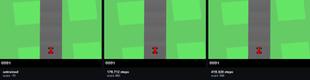
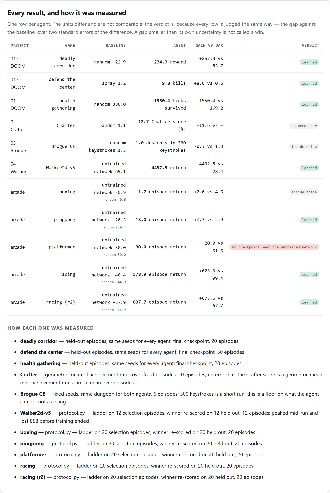
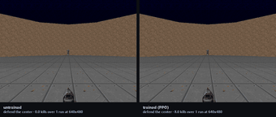
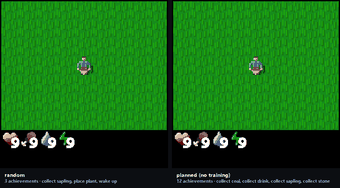
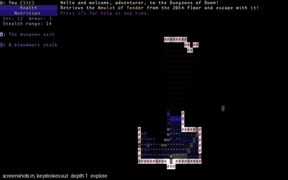
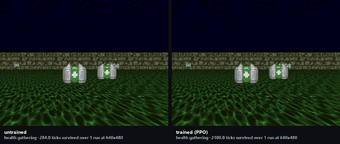
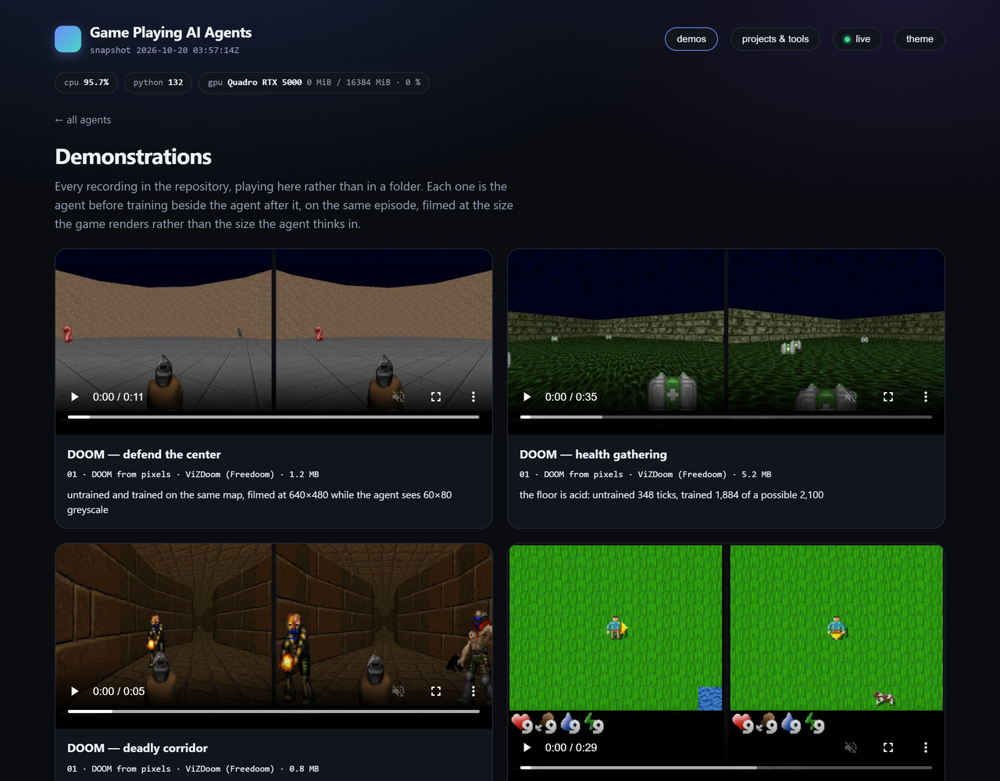
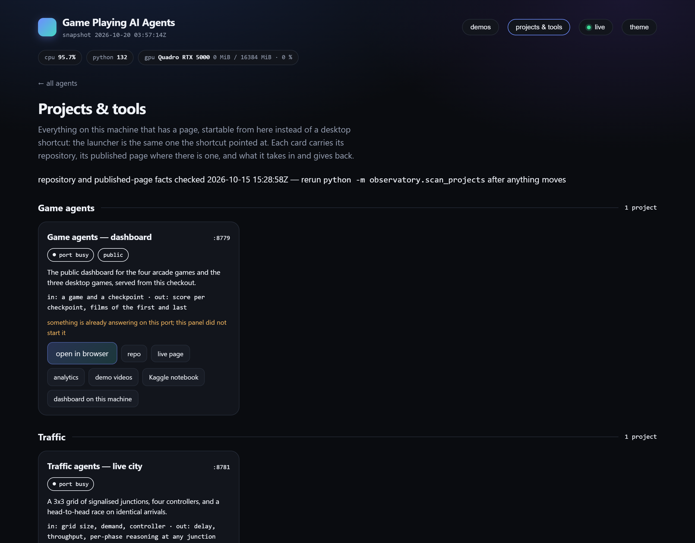

# game-agents

AI agents that play real games on a laptop CPU — and, more to the point, a way to
**see what learning actually did**.

Every trained game here keeps a checkpoint from **step 0**, before a single
gradient step, and the repository's main output is a video in which that
untrained network and the finished one play **the same level at the same time**.
No learning curve to interpret, no click to play: the untrained car spins on the
grass while the trained one follows the road.

There are two halves:

- **[The arcade](arcade/)** — one network and one PPO implementation across
  several games, each with a checkpoint ladder from untrained to finished.
- **Four one-off agents** — one learns DOOM from pixels across three maps, one
  teaches a MuJoCo robot to walk, one plans its way through Crafter with no
  weights at all, and one plays an ordinary Windows program through screenshots
  and keystrokes.

**[Live dashboard →](https://hammasbuilds.github.io/game-agents/)** ·
**[Analytics →](https://hammasbuilds.github.io/game-agents/analytics.html)** —
every figure on both is read from a run artefact in this repository, not typed in,
and the analytics page marks which differences are inside the noise of their own
measurement.
**[Kaggle notebook →](https://www.kaggle.com/code/muhammadhammas13/does-a-wider-network-help-a-doom-agent)**
— the same DOOM agent on a GPU, asking whether the laptop-sized network was a
compromise or was enough.



*Car racing. Four checkpoints of the same network playing the same track at the
same moment: never trained, then 60k, 180k and 419k steps. All four games are in
the [reel](docs/media/reel.mp4).*



*Every result in the repository, judged the same way. The units differ and are
not comparable; the verdict is. A gap smaller than its own uncertainty is not
called a win — three rows here say so.*

## What an hour of laptop CPU actually buys

Four games, one network, one PPO, one evaluation protocol — and four different
answers. Every row is scored on the same levels as its own untrained checkpoint,
and the verdict compares the two against **two standard errors of the
difference**, so a gain smaller than its own uncertainty is not called a win.

| game | untrained | best trained checkpoint | verdict |
|---|---:|---:|---|
| **Car racing** | −37.9 | **637.7** | learned — +676 against a bar of 68 |
| Table tennis | −20.2 | **−13.0** | learned — +7.2 against a bar of 2.9 |
| Boxing | −0.9 | 1.7 | inside noise — +2.6 against a bar of 4.5 |
| Platformer | 50.0 | 30.0 | **no trained checkpoint beat the untrained network** |

*Twenty held-out episodes per row: every checkpoint scored on the same episodes,
the best one chosen on a separate set. For scale, a random policy scores −45 at
racing, −20.4 at table tennis, and 50 at the platformer — where it beats every
trained checkpoint.*

That spread is the result, not an embarrassment to tidy away. Racing pays the
agent for every metre of road, so it learns from the first episode and ends up
driving. Kangaroo pays nothing until a ladder climb and a punch happen in
sequence, which random play almost never completes — so nothing pulls the
gradient anywhere and the policy narrows onto a single action. Scored properly,
**every trained Kangaroo checkpoint returns zero** while the untrained network
returns 50: two million steps produced something worse than the network they
started from, and worse than random play. The [arcade README](arcade/) shows the
action counts behind the collapse.

Boxing is the quieter non-result: two million steps, and the gain does not clear
its own uncertainty.

They deliberately share no method. The point of three is to show three ways of
getting a machine to play something — and what each one actually costs.



*DOOM, recorded at the resolution the game renders rather than the one the agent
thinks in. Left: the network before a single gradient step. Right: the same
network after 2M steps of PPO on a laptop CPU. The agent sees 60×80 greyscale in
both.*



*Crafter, 512×512. Left: random, 3 achievements. Right: the planner, 12 — and it
never trains anything. Both start from the same seed.*

| | |
|:---:|:---:|
|  |  |
| Brogue CE through screenshots and keystrokes, reached depth 3 | car racing: untrained, 180k and 419k steps on the same track |

| project | game | how it plays | result |
|---|---|---|---|
| [01 — DOOM from pixels](projects/01-doom-pixel-rl) | ViZDoom (Freedoom data) | PPO trained from scratch on raw frames, CPU only | three maps, all three beaten: see below |
| [02 — Crafter, planned](projects/02-crafter-planner) | Crafter | tile decoding → map → goal ladder, **no training at all** | **12.73%** Crafter score vs 1.13% random; 15 of 22 achievements |
| [03 — Brogue, through the screen](projects/03-brogue-screen-agent) | Brogue CE | screenshots in, keystrokes out, no API | names 77–94% of the dungeon view, explores and descends |
| [04 — a robot learns to walk](projects/04-mujoco-walk) | MuJoCo Walker2d | PPO with a Gaussian policy — an action is a torque per joint | training; the untrained robot and the trained one walk the same episode |

### DOOM, three maps

The same agent, the same hyper-parameters and the same evaluation on three
different scenarios — which is the only way to tell *this agent learned DOOM*
from *this agent learned one room*. Every verdict compares against the better of
the two hand-written baselines and the bar is two standard errors of the
difference.

| map | what it asks for | best baseline | PPO | verdict |
|---|---|---:|---:|---|
| defend the center | shoot what comes at you, 3 buttons | 1.2 kills | **9.8** | learned — +8.6 against a bar of 0.6 |
| health gathering | stay alive on acid, find medkits | 380 | **1,930** | learned — +1,550 against a bar of 169 |
| deadly corridor | walk a defended corridor, 4 buttons | −22.9 | **234** | learned — +257 against a bar of 84 |



*Health gathering. The floor is acid and health drains the whole time; the only
way to last is to keep finding medkits. Left: untrained, 348 ticks. Right:
trained, 1,884 — out of a 2,100-tick episode cap.*

Health gathering is also the clearest failure of the three. The first run
collapsed to a deterministic policy inside 92,000 steps and scored **below a
random agent** — 310 against random's 367, with the entropy of its action
distribution at 0.0017 out of a possible 1.10. Raising the entropy bonus from
0.01 to 0.03 and halving the learning rate turned that into 1,930.

## How everything here is scored

One file, [`protocol.py`](protocol.py), decides what every number in this
repository means. Three rules, each of them written down because this repository
got it wrong first:

**The last checkpoint is not the trained agent.** The walker reached 4,494 at
700k steps and finished at 3,637 by 2M — a decline of 858 against a bar of 786,
so real, but only just. It is the only run here whose decline clears that bar:
the others nominally peak early by margins of 0 to 1.4, which is nothing, and
the page says so rather than calling them peaks. Reporting the final checkpoint reports whichever point
training happened to stop at, so the ladder is scored and a checkpoint is
*chosen*.

Racing taught the other half of this, twice. Its film ladder appeared to decline
from 330 at 60k steps to 263 at 419k, and that decline was written up here. It
had been scored on **two tracks**, because the ladder beside the films exists to
choose what to film. Scored properly the same checkpoints rise the whole way.
Then the re-scoring itself turned out to be comparing against a random policy
while calling it "untrained" — the floor had been left in the candidate list,
first, where the baseline is read from. Both claims are corrected here:
twenty held-out episodes, baseline the untrained network, racing scores
**637.7 ± 33.5** against
**-37.9 ± 4.8**.

A second racing run with more than twice the steps, a gentler learning rate and
double the entropy bonus scored 637.7 ± 33.5
against the first run's 578.9 ± 49.5 —
**+58.8 against a bar of 119.6, inside noise.** The extra budget bought nothing
that can be measured.

**Choosing a checkpoint is itself a measurement, so it gets its own episodes.**
Picking the highest scorer on a set of episodes and then quoting that same score
reports the winner's luck as its skill. The ladder is scored on selection seeds;
the winner is re-scored on a disjoint set of reporting seeds; the reported
number is the second one.

**A gain counts only if it is larger than the uncertainty of the difference** —
two standard errors of it, not two standard deviations. An earlier version of
this repository compared means against the sum of their standard deviations and
called real learning noise.

A missing error bar is not a bar of zero. The Crafter score is a geometric mean
over achievement rates and has no standard error, so its row on the dashboard
says *no error bar* rather than claiming a win it cannot support.

| | measured against | episodes | verdict |
|---|---|---:|---|
| DOOM · defend the center | the better hand-written baseline | 30 | learned, +8.6 vs a bar of 0.6 |
| DOOM · health gathering | the better hand-written baseline | 20 | learned, +1,550 vs 169 |
| DOOM · deadly corridor | the better hand-written baseline | 20 | learned, +257 vs 84 |
| Crafter · planner | a random agent | 10 | 12.73% vs 1.13%, no error bar |
| Brogue · explorer | random keystrokes | 6 | **inside noise** on descents, −0.3 vs a bar of 1.3 |
| Walker2d | the same network, untrained | 12 | learned, +4,433 vs a bar of 28 |
| Car racing | the same network, untrained | 20 | learned, +676 vs a bar of 68 |
| Table tennis | the same network, untrained | 20 | learned, +7.2 vs a bar of 2.9 |
| Boxing | the same network, untrained | 20 | **inside noise**, +2.6 vs a bar of 4.5 |
| Kangaroo | the same network, untrained | 20 | **no trained checkpoint beat it** |

The Brogue row is the reason the table exists. The explorer names the dungeon
and dives on purpose, and over 300 keystrokes it still does not descend more
often than random keystrokes do. That is the result; the dashboard prints it in
the same table as the wins.

## Where the games come from

**None of these games were written here.** They are real games, downloaded and
run unmodified; the code in this repository is the agents that play them and the
harness that measures them.

| game | what it is | where it comes from | what it renders |
|---|---|---|---|
| DOOM | the 1993 engine, with the free **Freedoom** data | `vizdoom` (pip), data shipped with it | 640×480 textured 3D |
| Crafter | a 2021 open-source survival game | `crafter` (pip) | any size; 512×512 here |
| Brogue CE | a GPL roguelike, the real Windows build | `scripts/get_brogue.py` downloads the release | an 80×30 character grid |
| Car racing | Gymnasium's Box2D `CarRacing-v3` | `gymnasium[box2d]` (pip) | 600×400 |
| Walker2d | a MuJoCo robot | `mujoco` + `gymnasium` (pip) | any size; 480×480 here |
| Boxing · Kangaroo · Pong *(retired)* | **Atari 2600**, 1977–1982 | ROMs shipped under licence with `ale-py` | 160×210, 128 colours |

No commercial ROMs, nothing patched, nothing emulated by hand. The games are not
committed to this repository — each one is a package install or a download.

The Atari three are retired from the showcase for exactly the reason their
resolution column suggests: a 1980 console cannot be made to look good next to a
640×480 DOOM render, however well the agent plays. They keep their entries,
their checkpoint ladders and their numbers — including the two unflattering
ones — on the dashboard under *retired*.

## What each project is really about

**01** is about throughput. Written the obvious way the trainer ran at 153
steps/s while a single environment did 1,305, and four rounds of profiling each
disproved the obvious answer before the instrumented worker gave it up: a worker
sleeping in `recv()` pays a scheduler-tick wake-up on every step, and since
Windows 10 2004 the timer resolution is **per process**, so the fix belongs in
the worker, not the trainer. One line, 5.2×, and a 2M-step run that finishes in
an hour.

**02** is about whether a plan can stand in for a policy. It can, here: a goal
ladder with no weights reaches roughly what a trained world model reports on the
same benchmark. It is also about not cheating — Crafter offers a full semantic
map in its `info` dict, and the planner reads none of it, decoding the 64×64
frame instead at 99.99% tile accuracy (100% in daylight, 99.5% at midnight, where
the game blends in random noise that can only be removed in expectation).

**03** is about the gap between a game that wants to be automated and one that
does not. Brogue has no API, so the agent starts the process, finds the window,
screenshots the client area and posts keystrokes to that window handle — which
means they go to the game and never into whatever else is open. The hard part was
not the agent but the reading: Brogue stretches its 100×34 character grid over
the whole window, so cells are 9.08 × 16.68 pixels and nothing lands on an
integer lattice.

## What it cost to get there

Every number above came after the first version of that project was bad, and the
fixes came from watching, not from tuning. A few that are written up next to the
code they broke:

- A template atlas built the game's own way was **transposed**, because Crafter
  keeps textures in (x, y) and transposes only the finished canvas. 25% of tiles
  wrong, mostly grass read as stone.
- The Crafter planner walked past three trees to reach a cow eleven tiles away,
  because food was at 3/9 and "hungry" outranked "collect wood".
- It then died at step 223 having spent forty steps fleeing zombies **with nine
  unused stone in the inventory**. Three separate bugs stood between it and
  building a wall; the one that took longest to see was that `seal()` re-chose
  the most exposed side every step, and since the zombies moved, the agent turned
  back and forth and never placed a block.
- Having learned to seal itself in, it starved behind its own wall, because
  nothing opened the box again.
- Choosing between two decoders by "whichever matches better" compared cosine
  similarities across a three-channel and a one-channel space, where the smaller
  space always wins. Accuracy fell to 0.6% before the comparison was replaced
  with the sleep screen's exact algebraic signature.

## The dashboard

`docs/` is a static page — no build step, no server, no CDN — served at
[hammasbuilds.github.io/game-agents](https://hammasbuilds.github.io/game-agents/).
`ui/export.py` fills it from the run artefacts each project writes, so a result
the page shows is one some run produced; where a run is missing, the card says so
instead of showing a stale number. `ui/check_page.py` checks the page without
opening a browser: files it references but does not ship, CSS variables used but
never defined, anything loaded from a third party, and numbers typed into the
HTML rather than read from the data.

```bash
python ui/export.py && python ui/check_page.py
```



*The control panel, `python -m observatory.server --open`: start and stop
training, watch any of the ten demonstrations, and open any project on this
machine. The films are the agent before training beside the agent after it.*

## Projects & tools

The panel's second half is a launcher for everything on this machine that has a
page. Twenty-nine of them, the same launchers the desktop shortcuts pointed at,
grouped and startable from one place — with the three things a shortcut cannot
tell you.

```bash
python -m observatory.scan_projects    # check the catalogue against the machine
python -m observatory.server --open    # the panel, with the launcher in it
```



| it says | because |
|---|---|
| whether a port is answering, separately from whether this panel started it | five ports on this box are claimed by two projects each — 8765 by StudyLoop and the pak-law demo, 8781 by the traffic panel and the PsyReason studio — so "something is answering" is not "your project is up" |
| the repository, only when it is public | 12 of the 29 are public; a GitHub link to a private repo is a 404 for everybody but its owner, so the private ones say *repo private* rather than offering a dead link |
| the published page, only when it answered | 4 have one. The other 25 were checked and have none, and are shown that way rather than linked hopefully |
| what it takes in and gives back | one line per project, so the card says what the thing is *for* before you start it |

Start is the same launcher the shortcut ran, in its own console window, and the
tab opens only once the port actually answers — these launchers spend a few
seconds finding an interpreter, and a tab opened immediately lands on a
connection refused. Stop kills the process tree, and only for something this
panel started: a server it did not start is reported, not killed.

Nothing a request contains becomes a command. A POST names an id, the catalogue
supplies the launcher, and the desktop window's links are opened by the server
from a fixed set of 42 addresses built from that same catalogue.

The scan is dated, because every line of it is a measurement of this machine at
one moment — a checkout moves, a repo goes public, a launcher is renamed.

## Tests

```bash
python -m pytest tests -q        # 41 passed
```

The agents are judged by playing — that is what the evaluation scripts are for.
The tests pin the machinery underneath, where a quiet mistake moves a score
without crashing anything: the advantage estimator and its episode boundary, the
uint8 normalisation the policy depends on, the pathfinder, the shelter geometry,
the achievement inference (including its deliberate refusal to claim a kill when
a monster merely stepped aside), and the character grid the Brogue decoder cuts
out of a frame. One of them encodes the rule that cost the most games: the agent
must not press `<` on depth 1, because that leaves the dungeon and ends the run.

## Running them

```bash
python -m venv .venv && .venv/Scripts/activate      # or source .venv/bin/activate
pip install -r requirements.txt
pip install torch --index-url https://download.pytorch.org/whl/cpu

cd projects/01-doom-pixel-rl   && python train.py --scenario defend_the_center --steps 2000000
cd projects/02-crafter-planner && python evaluate.py --agent all --episodes 20
cd projects/03-brogue-screen-agent && python ../../scripts/get_brogue.py && python play.py
```

Everything here runs on a CPU. The DOOM run is the longest at under an hour on 12
cores; the other two are minutes.
