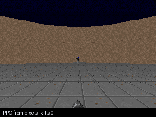
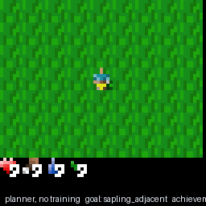

# game-agents

AI agents that play real games on a laptop CPU — and, more to the point, a way to
**see what learning actually did**.

Every trained game here keeps a checkpoint from **step 0**, before a single
gradient step, and the repository's main output is a video in which that
untrained network and the finished one play **the same level at the same time**.
No learning curve to interpret, no click to play: the untrained car spins on the
grass while the trained one follows the road.

There are two halves:

- **[The arcade](arcade/)** — car racing, boxing, a platformer and table tennis,
  all learned by one network with one PPO implementation, with a checkpoint
  ladder from untrained to finished.
- **Three one-off agents** — one learns DOOM from pixels, one plans its way
  through Crafter with no weights at all, and one plays an ordinary Windows
  program through screenshots and keystrokes.

**[Live dashboard →](https://hammasbuilds.github.io/game-agents/)** ·
**[Analytics →](https://hammasbuilds.github.io/game-agents/analytics.html)** —
every figure on both is read from a run artefact in this repository, not typed in,
and the analytics page marks which differences are inside the noise of their own
measurement.
**[Kaggle notebook →](https://www.kaggle.com/code/muhammadhammas13/does-a-wider-network-help-a-doom-agent)**
— the same DOOM agent on a GPU, asking whether the laptop-sized network was a
compromise or was enough.


*Car racing. Four checkpoints of the same network playing the same track at the
same moment: never trained, then 60k, 180k and 419k steps. All four games are in
the [reel](docs/media/reel.mp4).*

## What an hour of laptop CPU actually buys

Four games, one network, one PPO, one evaluation protocol — and four different
answers. Every row is scored on the same levels as its own untrained checkpoint,
and the verdict compares the two against **two standard errors of the
difference**, so a gain smaller than its own uncertainty is not called a win.

| game | untrained | trained | verdict |
|---|---:|---:|---|
| **Car racing** | −53.7 | **+376.0** | learned — +429.7 against a bar of 130.2 |
| Table tennis | −20.0 | −16.6 | learned — +3.4 against a bar of 2.1 |
| Boxing | 2.1 | 1.6 | no gain — −0.5 against a bar of 3.4 |
| Platformer | 25.0 | 0.0 | **worse than untrained** — it collapsed onto one button |

That spread is the result, not an embarrassment to tidy away. Racing pays the
agent for every metre of road, so it learns from the first episode and ends up
driving. Kangaroo pays nothing until a ladder climb and a punch happen in
sequence, which random play almost never completes — so nothing pulls the
gradient anywhere, the policy narrows onto a single action, and two million steps
produce something worse than the network you started with. The
[arcade README](arcade/) shows the action counts that prove the collapse rather
than asserting it.

They deliberately share no method. The point of three is to show three ways of
getting a machine to play something — and what each one actually costs.

| | | |
|:---:|:---:|:---:|
|  |  |  |
| PPO from pixels, 12 kills in this episode | the planner, 8 achievements, no training | screenshots and keystrokes, reached depth 3 |

| project | game | how it plays | result |
|---|---|---|---|
| [01 — DOOM from pixels](projects/01-doom-pixel-rl) | ViZDoom (Freedoom data) | PPO trained from scratch on raw frames, CPU only | **9.80 kills/episode** vs 1.23 for a hand-written baseline, 30 held-out maps |
| [02 — Crafter, planned](projects/02-crafter-planner) | Crafter | tile decoding → map → goal ladder, **no training at all** | **12.73%** Crafter score vs 1.13% random; 15 of 22 achievements |
| [03 — Brogue, through the screen](projects/03-brogue-screen-agent) | Brogue CE | screenshots in, keystrokes out, no API | names 77–94% of the dungeon view, explores and descends |

Every game is free and open: ViZDoom ships Freedoom, Crafter is a pip install,
Brogue CE is a GPL release download. No ROMs, nothing commercial, nothing
patched. The games themselves are not committed — `scripts/get_brogue.py`
fetches Brogue, and the other two are Python packages.

## What each project is really about

**01** is about throughput. Written the obvious way the trainer ran at 153
steps/s while a single environment did 1,305, and four rounds of profiling each
disproved the obvious answer before the instrumented worker gave it up: a worker
sleeping in `recv()` pays a scheduler-tick wake-up on every step, and since
Windows 10 2004 the timer resolution is **per process**, so the fix belongs in
the worker, not the trainer. One line, 5.2×, and a 2M-step run that finishes in
an hour.

**02** is about whether a plan can stand in for a policy. It can, here: a goal
ladder with no weights reaches roughly what a trained world model reports on the
same benchmark. It is also about not cheating — Crafter offers a full semantic
map in its `info` dict, and the planner reads none of it, decoding the 64×64
frame instead at 99.99% tile accuracy (100% in daylight, 99.5% at midnight, where
the game blends in random noise that can only be removed in expectation).

**03** is about the gap between a game that wants to be automated and one that
does not. Brogue has no API, so the agent starts the process, finds the window,
screenshots the client area and posts keystrokes to that window handle — which
means they go to the game and never into whatever else is open. The hard part was
not the agent but the reading: Brogue stretches its 100×34 character grid over
the whole window, so cells are 9.08 × 16.68 pixels and nothing lands on an
integer lattice.

## What it cost to get there

Every number above came after the first version of that project was bad, and the
fixes came from watching, not from tuning. A few that are written up next to the
code they broke:

- A template atlas built the game's own way was **transposed**, because Crafter
  keeps textures in (x, y) and transposes only the finished canvas. 25% of tiles
  wrong, mostly grass read as stone.
- The Crafter planner walked past three trees to reach a cow eleven tiles away,
  because food was at 3/9 and "hungry" outranked "collect wood".
- It then died at step 223 having spent forty steps fleeing zombies **with nine
  unused stone in the inventory**. Three separate bugs stood between it and
  building a wall; the one that took longest to see was that `seal()` re-chose
  the most exposed side every step, and since the zombies moved, the agent turned
  back and forth and never placed a block.
- Having learned to seal itself in, it starved behind its own wall, because
  nothing opened the box again.
- Choosing between two decoders by "whichever matches better" compared cosine
  similarities across a three-channel and a one-channel space, where the smaller
  space always wins. Accuracy fell to 0.6% before the comparison was replaced
  with the sleep screen's exact algebraic signature.

## The dashboard

`docs/` is a static page — no build step, no server, no CDN — served at
[hammasbuilds.github.io/game-agents](https://hammasbuilds.github.io/game-agents/).
`ui/export.py` fills it from the run artefacts each project writes, so a result
the page shows is one some run produced; where a run is missing, the card says so
instead of showing a stale number. `ui/check_page.py` checks the page without
opening a browser: files it references but does not ship, CSS variables used but
never defined, anything loaded from a third party, and numbers typed into the
HTML rather than read from the data.

```bash
python ui/export.py && python ui/check_page.py
```

## Projects & tools

The panel's second half is a launcher for everything on this machine that has a
page. Twenty-nine of them, the same launchers the desktop shortcuts pointed at,
grouped and startable from one place — with the three things a shortcut cannot
tell you.

```bash
python -m observatory.scan_projects    # check the catalogue against the machine
python -m observatory.server --open    # the panel, with the launcher in it
```

| it says | because |
|---|---|
| whether a port is answering, separately from whether this panel started it | five ports on this box are claimed by two projects each — 8765 by StudyLoop and the pak-law demo, 8781 by the traffic panel and the PsyReason studio — so "something is answering" is not "your project is up" |
| the repository, only when it is public | 12 of the 29 are public; a GitHub link to a private repo is a 404 for everybody but its owner, so the private ones say *repo private* rather than offering a dead link |
| the published page, only when it answered | 4 have one. The other 25 were checked and have none, and are shown that way rather than linked hopefully |
| what it takes in and gives back | one line per project, so the card says what the thing is *for* before you start it |

Start is the same launcher the shortcut ran, in its own console window, and the
tab opens only once the port actually answers — these launchers spend a few
seconds finding an interpreter, and a tab opened immediately lands on a
connection refused. Stop kills the process tree, and only for something this
panel started: a server it did not start is reported, not killed.

Nothing a request contains becomes a command. A POST names an id, the catalogue
supplies the launcher, and the desktop window's links are opened by the server
from a fixed set of 42 addresses built from that same catalogue.

The scan is dated, because every line of it is a measurement of this machine at
one moment — a checkout moves, a repo goes public, a launcher is renamed.

## Tests

```bash
python -m pytest tests -q        # 41 passed
```

The agents are judged by playing — that is what the evaluation scripts are for.
The tests pin the machinery underneath, where a quiet mistake moves a score
without crashing anything: the advantage estimator and its episode boundary, the
uint8 normalisation the policy depends on, the pathfinder, the shelter geometry,
the achievement inference (including its deliberate refusal to claim a kill when
a monster merely stepped aside), and the character grid the Brogue decoder cuts
out of a frame. One of them encodes the rule that cost the most games: the agent
must not press `<` on depth 1, because that leaves the dungeon and ends the run.

## Running them

```bash
python -m venv .venv && .venv/Scripts/activate      # or source .venv/bin/activate
pip install -r requirements.txt
pip install torch --index-url https://download.pytorch.org/whl/cpu

cd projects/01-doom-pixel-rl   && python train.py --scenario defend_the_center --steps 2000000
cd projects/02-crafter-planner && python evaluate.py --agent all --episodes 20
cd projects/03-brogue-screen-agent && python ../../scripts/get_brogue.py && python play.py
```

Everything here runs on a CPU. The DOOM run is the longest at under an hour on 12
cores; the other two are minutes.
